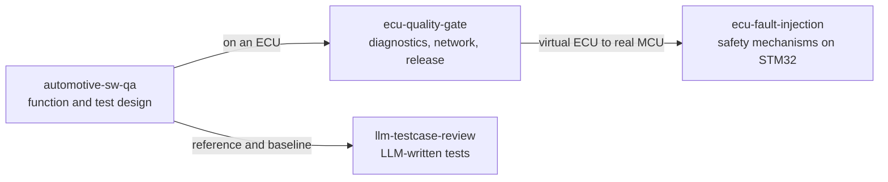

<h1 align="center">Eungyun Im</h1>

  <b>Automotive software quality · verification · field testing</b> 
  Autonomous driving software that holds up outside the lab.

  
  
  

3rd-year Automotive Engineering student at Kookmin University, President of [KUUVe](https://github.com/KUUVe-KMU), the autonomous driving research club. I build perception and control for scale cars, and I care about the gap between benchmark numbers and field behavior. Tracing failures on a real car led me to software verification: designing tests from requirements, injecting faults on purpose, and measuring whether the tests themselves are any good.

---

## Featured work

One emergency-braking function, verified at four levels.

| Project | Level | What it shows |
|---|---|---|
| **[automotive-sw-qa](https://github.com/eungyun-im/automotive-sw-qa)** | Unit | Simulink model, C code and Python reference compared back to back; coverage up to MC/DC, mutation testing, requirement traceability, formal proof of the requirements and fault injection in MATLAB. |
| **[ecu-quality-gate](https://github.com/eungyun-im/ecu-quality-gate)** | ECU and network | Release gate: UDS over ISO-TP, CAN timing and security checks on a virtual bench; seven planted defects prove the suites catch them. |
| **[ecu-fault-injection](https://github.com/eungyun-im/ecu-fault-injection)** | Hardware | Lost and corrupted commands, a stuck CPU, bus-off and interrupted firmware updates on an STM32. One suite for simulation and board; the board run is pending. |
| **[llm-testcase-review](https://github.com/eungyun-im/llm-testcase-review)** | Test design | LLM-written test cases measured by executing them on reference and defect versions, then repaired with feedback. |

---

## Stack

---

## Experience and awards

`2026.01 — now` President, KUUVe (Kookmin University Unmanned Vehicle)  
`2025.06 — now` Field Test Engineer, KUUVe Scale Car Project  
`2023 — now` &nbsp;&nbsp;B.E. Automotive Engineering, Kookmin University

| Date | Competition | Award |
|---|---|---|
| 2026.10 | Autonomous Robot Race, Round 3 | **Excellence Award (3rd)** |
| 2026.07 | SEA:ME Hackathon (Volkswagen Foundation) | **Gold Prize** |
| 2026.03 | 5th Int'l University EV Autonomous Driving Competition | **Effort Award** |
| 2025.11 | International Robot Contest, TurtleBot3 Autorace | **Encouragement Award** |
