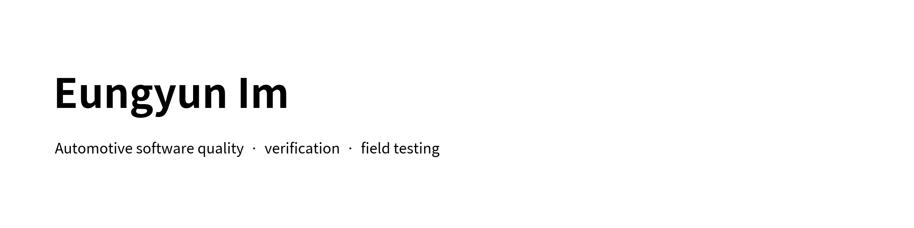

  
  
  

3rd-year Automotive Engineering student at Kookmin University, President of 2026[KUUVe](https://github.com/KUUVe-KMU), the autonomous driving research club. I build perception and control for scale cars, and I care about the gap between benchmark numbers and field behavior. Tracing failures on a real car led me to software verification: designing tests from requirements, injecting faults on purpose, and measuring whether the tests themselves are any good.

---

## Featured work

### Verification

| Project | Level | What it shows |
|---|---|---|
| **[baremetal-nmpc-hils-verification](https://github.com/eungyun-im/baremetal-nmpc-hils-verification)** | Real MCU in the loop | Capstone. A nonlinear MPC without an OS on an NXP S32K312, verified with unit tests, coverage, mutation testing, fault injection and 468 recorded laps. The path-error criterion failed, and the repository traces why. |
| **[aeb-ecu-verification](https://github.com/eungyun-im/aeb-ecu-verification)** | Function up to ECU | One AEB function checked on Simulink, C and Python (MC/DC, mutation), then run inside a Brake ECU on a virtual CAN bus with UDS, timing and security tests, seven planted defects and a release gate. Integration tests check that both levels agree. |

### Autonomous driving (KUUVe)

Competition code. Each README lists what was checked and what was not.

| Project | Competition | What it shows |
|---|---|---|
| **[waypoint-follower](https://github.com/eungyun-im/waypoint-follower)** | Autonomous Robot Race, Excellence Award | ROS 2 path tracking for ERP42: pure pursuit with Stanley, curvature speed profile, input watchdogs, 29 scenario tests |
| **[fsd-path-planner](https://github.com/eungyun-im/fsd-path-planner)** | Int'l Univ. EV Autonomous Driving, Effort Award | Cone-track planning: Delaunay/Voronoi centerline, 11 candidate paths, RRT* fallback, stop after repeated planning failures |
| **[topst-ufld-lane](https://github.com/eungyun-im/topst-ufld-lane)** | SEA:ME Hackathon, Gold Prize | UFLD lane detection on a TOPST D3-G without an NPU (TNN OpenCL), with model-decoder contract checks |
| **[t870-vehicle-bridge](https://github.com/eungyun-im/t870-vehicle-bridge)** | HL FMA 2026, Encouragement Award | Arduino Mega firmware (motor PWM, encoder interrupt, watchdog) and a ROS steering loop over a binary serial link |

---

## Stack

---

## Experience and awards

`2026.01 — 2026.12` President, KUUVe (Kookmin University Unmanned Vehicle)  
`2025.06 — 2026.12` KUUVe Scale Car Project  
`2022 — now` &nbsp;&nbsp;B.E. Automotive Engineering, Kookmin University

| Date | Competition | Award |
|---|---|---|
| 2026.10 | Autonomous Robot Race, Round 3 | **Excellence Award (3rd)** |
| 2026.10 | HL FMA (Future Mobility Award) 2026 Autonomous Driving Competition | **Encouragement Award** |
| 2026.07 | SEA:ME Hackathon (Volkswagen Foundation) | **Gold Prize** |
| 2026.03 | 5th Int'l University EV Autonomous Driving Competition | **Effort Award** |
| 2025.11 | International Robot Contest, TurtleBot3 Autorace | **Encouragement Award** |
